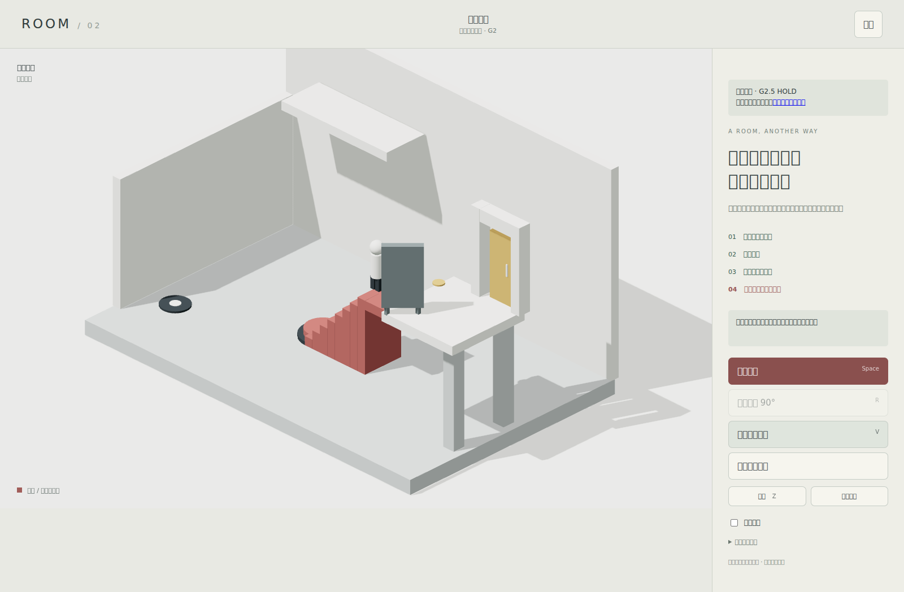

# ROOM online browser evidence

Generated by the repository's `Verify ROOM test site` workflow.
See `latest/smoke.json` for the actual URL, deployed source commit, browser version and assertions.
A `latest/failure.json` records a failed attempt and must not be presented as a successful validation.
Screenshots, when present, are real hosted-site browser output, not local preflight images.

