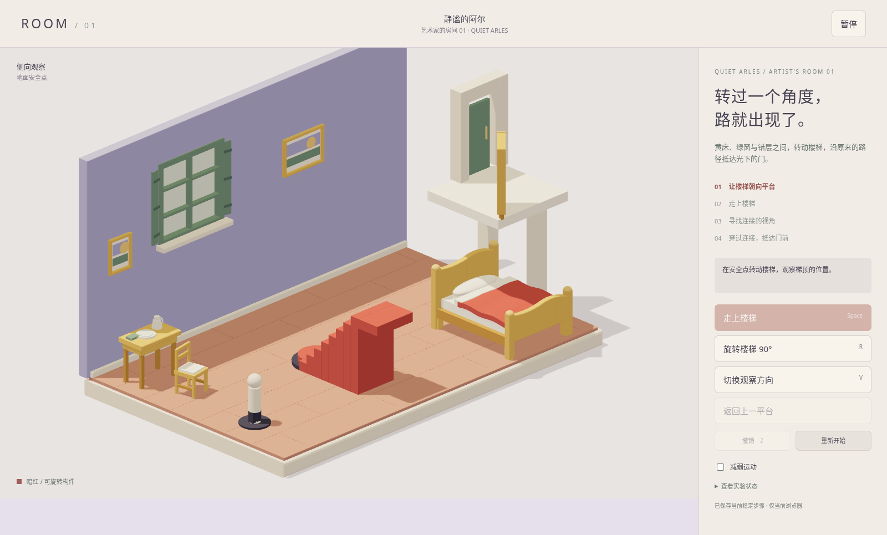
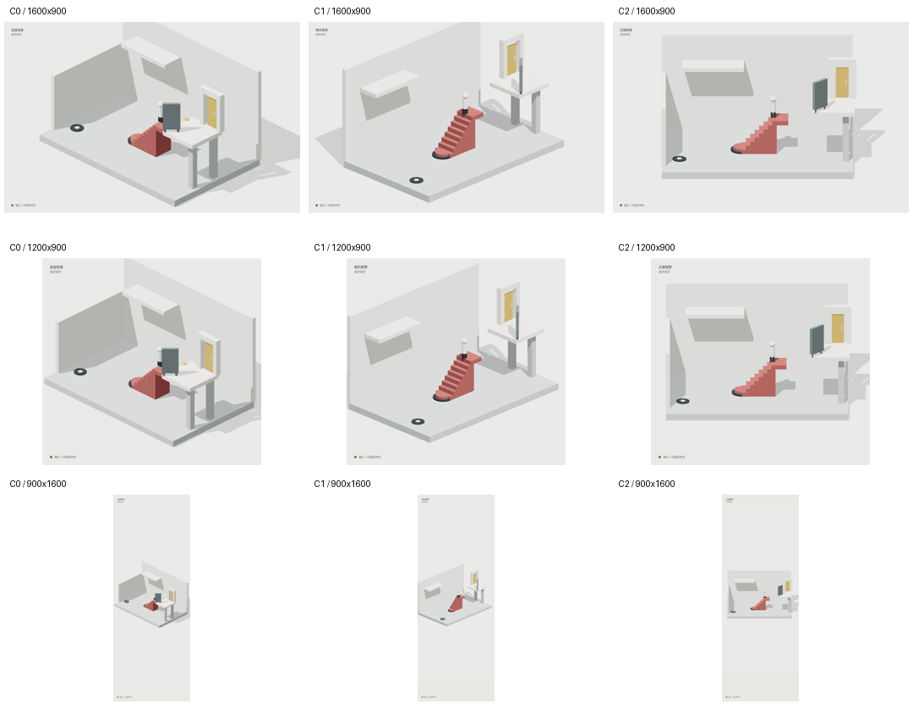

# ROOM / Quiet Arles — 静谧的阿尔

本分支提供“艺术家的房间 01”可玩美术样板：黄床红被、绿窗、蓝紫墙、暖色地板和分层桌椅；原 G2 解法与相机控制保留。**G2.5 HOLD：尚未正式验收。**

**[打开 Quiet Arles 在线试玩](https://tony-zhang-notfound.github.io/Room-Monument-Valley/quiet-arles/)** · [下载单文件版](https://tony-zhang-notfound.github.io/Room-Monument-Valley/quiet-arles/ROOM_G2_Play.html) · [线上交互验证](https://github.com/Tony-Zhang-NotFound/Room-Monument-Valley/actions/runs/39182575951)

26 项测试、可复现构建及真实线上 Chrome 155 交互检查已通过。[线上截图与原始结果](evidence/quiet-arles/online/)独立保存。此预览与原 G2 共用兼容存档；查看默认构图可点“重新开始”。原试玩根路径、main 和冻结基线保持原样。



[美术样板验收报告](docs/QUIET_ARLES_ACCEPTANCE.md) · [同视角前后对比](evidence/quiet-arles/before-after.png) · [床局部](evidence/quiet-arles/after/bed-detail.png) · [新九宫格](evidence/quiet-arles/nine-view-overview.png) · [资产清单](docs/quiet-arles-assets.json)

直接下载本分支 `ROOM_G2_Play.html` 用桌面 Chrome/Edge 打开，或在仓库根目录运行 `python3 -m http.server 8882 --bind 127.0.0.1`。没有应用依赖安装；`node --test tests/*.test.mjs` 执行当前 26 项检查。需要重建单文件时运行 `node scripts/bundle.mjs`。完整基线复现与真实浏览器命令见 [Quiet Arles 工程说明](docs/QUIET_ARLES.md)。

家具、窗口和装饰是原创程序化几何；参考图片不作为贴图，也不进入游戏包。旧 `models/*.glb` 保留为 G2 参考导出。性能限制：同一云端 SwiftShader 完整路线约 8.35→6.87 FPS，空闲按需渲染不冒充 60 FPS；真实 GPU/手机性能仍待验收。

---

## 历史 G2 与测试站说明

以下为原 G2 交付记录；原试玩根地址继续保留，新美术未合并到 main。当前美术结果以上述报告为准。

> 最新验收见 [G2_5_ACCEPTANCE.md](G2_5_ACCEPTANCE.md)：本地工程检查及真实 WebGL 浏览器验收通过，九宫格和视频已保存；作者视觉签核和目标设备验收仍待完成，维持 HOLD G3。

# ROOM / 悬梯之间 · G2 v0.2

本轮把资产库 v0.1 的旋转梯、门框、旅人和安全标记组合为一条可以按规则完成的短路径。黑白灰建筑、暗红机关、赭黄终点；无描边和纹理贴图。

代码仓库：[Tony-Zhang-NotFound/Room-Monument-Valley](https://github.com/Tony-Zhang-NotFound/Room-Monument-Valley)。代码、历史及验收成果已同步；代码同步和测试部署均不代表正式发布或 G2.5 自动通过。

**[打开可交互测试试玩网站](https://tony-zhang-notfound.github.io/Room-Monument-Valley/)** · [下载单文件试玩版](https://tony-zhang-notfound.github.io/Room-Monument-Valley/ROOM_G2_Play.html)

GitHub Pages 已部署成功，真实线上浏览器已验证场景、旋转、移动、视角、通关与重置。**G2.5 HOLD 继续保留**，此地址为测试试玩。部署与检查方法见 [部署说明](docs/DEPLOYMENT.md)，[线上截图及结果](https://github.com/Tony-Zhang-NotFound/Room-Monument-Valley/tree/deployment-evidence/latest)由独立证据分支保存。

## G2.5 浏览器九宫格

真实 Chromium / WebGL 截图：列为 C0 / C1 / C2，行依次为 1600×900、1200×900、900×1600。下图由原始画布截图缩略排列；使用 SwiftShader 软件渲染，不代表目标设备性能。



[查看原始截图、视频与日志](evidence/g2_5/current/) · [逐项验收报告及未完成事项](G2_5_ACCEPTANCE.md)

## 直接开始

下载 `ROOM_G2_Play.html`，用支持 WebGL 2 的桌面 Chrome / Edge 双击打开。此单文件已包含全部运行代码与样式，不请求 CDN、不需账号或安装依赖。浏览器可能限制本地文件存档，失败时游戏会提示，仍可继续本次会话。

如果本机浏览器限制本地 HTML，可在解压目录启动本地服务器：

```sh
python -m http.server 8765 --bind 127.0.0.1
```

Windows 也可用 `py -m http.server 8765 --bind 127.0.0.1`。打开 `http://localhost:8765` 查看分文件源码版；单文件版行为与源码版来自同一套代码。

## 操作

| 操作 | 按钮 / 键盘 |
|---|---|
| 旋转 90° | 旋转楼梯 / R；也可点中暗红梯体 |
| 下一段路径 | 主按钮 / Space；也可点中目标标记 |
| 切换视角 | 切换观察方向 / V |
| 回到上一平台 | 返回上一平台 |
| 撤销稳定步骤 | 撤销 / Z |
| 暂停与继续 | 暂停 / Esc |
| 立即回到初态 | 重新开始；可中断正在播放的动作 |

离开标签页会自动暂停；返回后按“继续”。勾选“减弱运动”可跳过移动、旋转与相机动画。没有音频。
稳定步骤保存于浏览器 localStorage；没有登录、云同步、跨设备存档或联网功能。

首次验证路线（含解法）：旋转一次 → 走上楼梯 → 切换视角两次至“连接视角” → 穿过连接 → 走向门。初始楼梯状态为 270°，一转回到 0°。初始观察视角为 C1。

## 包内内容

- `src/game.mjs`：与渲染解耦的状态、条件、撤销、存档验证。
- `src/level.mjs`：角色安全点、路线、指定视角与遮挡屏参数。
- `src/scene.mjs`：本关建筑装配；`assets-source.js` 来源于本项目资产库。
- `src/main.mjs`：画面、按钮、键盘、动画、暂停、本地保存。
- `models/`：初态、对齐、终点三个静态 GLB 快照；游戏运行时使用参数化几何。
- `previews/G2_SEQUENCE.png`：实际几何的四阶段 CPU 渲染，并非浏览器截图。
- `docs/`：平面/剖面示意、机关合同、验收状态。
- `tests/`：规则、几何、界面控制逻辑与打包检查。

## 开发命令

需要 Node.js 18+，依赖已经随包提供，不必 npm install。

```sh
node scripts/bundle.mjs
node --test tests/*.test.mjs
node scripts/export.mjs
```

预览图生成另需 Python、numpy、Pillow 和中文字体，`ROOM_FONT` 指向字体文件后运行 `python scripts/render.py`。这套 CPU 阴影近似不与 WebGL 逐像素一致。

## 验收边界

19 项自动检查通过，包含基线行为比较、21 个稳定状态、路径、输入锁定、撤销、重置、保存及几何检查。DOM/WebGL 替身测试仍保留；本轮另以真实 Chromium / WebGL 2 执行完整交互和九宫格验收，源码版及单文件版均能完成旅程。
证据在 `evidence/g2_5/current/`，包括截图、视频、环境信息及逐项结果。浏览器使用 SwiftShader 软件渲染，不能代表真实设备性能；真人试玩及作者视觉签核未完成。当前为 **本地工程检查通过，HOLD G3**。`validation-report.json`、根层旧证据和冻结合同是交接时的历史结果，最新状态以验收报告为准。

独立 ROOM 项目的远程目标为 `Tony-Zhang-NotFound/Room-Monument-Valley`。用户已授权以非强制推送同步 `main`、`g2.5-acceptance` 和 `g2-baseline`，保留历史。没有使用或修改作品集仓库。

尚未完成：作者视觉容差与连接体验签核、目标设备性能验收、未看解法的真人试玩；完整 Booklet 也仍待补齐。托管部署及线上浏览器 CI 已通过；19 项纯逻辑/几何检查的证据仍为本地及干净克隆运行，未声称已在远程 CI 重跑。测试部署不改变 HOLD G3 结论，正式发布仍未执行。

## 来源

程序几何和游戏代码为本项目本轮制作，保留资产库 v0.1 原包；未打包参考原图。Three.js 0.170.0 为 MIT，许可证在 `vendor/THREE-LICENSE.txt`。没有接入 Supabase 或执行部署。
